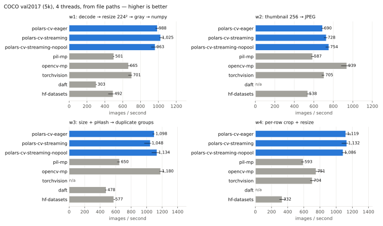

# polars-cv vs PIL, OpenCV, torchvision, Daft and Hugging Face datasets

A reproducible comparison on COCO val2017: four workloads, nine
implementations, two input sources, one thread and all cores. Every
implementation is held to the PIL reference by parity tests before anything is
timed, and every number below comes from `results/*.json`, which also records
the hardware and every library version.

This directory is its own uv project. It benchmarks the **published**
`polars-cv` wheel (pinned in `pyproject.toml`), which is what users install,
not the local checkout. The regression suite that measures the checkout lives
in [`polars-cv/benchmarks/`](../polars-cv/benchmarks/).

## Results

4 threads (all cores), COCO val2017, files read from paths, polars-cv 0.37.0.
Images per second is the median of 5 runs, with the interquartile range in the
full tables. Peak memory is the PSS of the process and its workers.



| Workload (5,000 images) | polars-cv | Best other | Next best | polars-cv peak memory |
|---|---:|---:|---:|---:|
| **w1** decode → 224² → gray → numpy | **1,068** | torchvision 684 | OpenCV 629 | **625 MiB** (OpenCV 1,240, torchvision 1,156) |
| **w2** thumbnail → JPEG | 681 | **OpenCV 903** | torchvision 684 | 243 MiB (OpenCV 199) |
| **w3** size + pHash → duplicate groups | 506 | **OpenCV 1,084** | PIL 520 | 136 MiB (OpenCV 126) |
| **w4** per-row crop + resize | **1,047** | OpenCV 742 | torchvision 628 | **679 MiB** (OpenCV 2,606, torchvision 1,865) |

**Where polars-cv wins**

- **w1 and w4 run 1.4–1.6× faster than the best alternative, in half to a
  quarter of the memory.** Decode, resize and grayscale run in Rust on one
  pool with no per-image Python, and w4's per-row crop box and size are just
  column expressions. The process-pool libraries pickle every result back to
  the parent; polars-cv writes straight into one Arrow buffer.
- **It holds up at 50,000 images.** w1 runs at 938 img/s (eager) and 864
  (streaming), against 680 for torchvision and 647 for OpenCV, and peaks at
  4.9–5.1 GiB, the lowest of all (torchvision and Daft 5.3, PIL 7.1, OpenCV 10.8). Most
  of that is the 2.3 GiB output array itself. Hugging Face `datasets` passed the 12 GiB cap on w1 at 50k and was
  stopped.

**Where polars-cv loses, and why**

- **w2: OpenCV is 1.3× faster.** polars-cv decodes and resizes as fast as
  OpenCV (3.2 ms against 3.9 ms per image, single thread), but its JPEG
  encoder, the pure-Rust `image` crate's, takes 3.2 ms for a 256-px thumbnail
  where libjpeg-turbo takes 0.27 ms. OpenCV's `INTER_LINEAR` is also cheaper
  than an antialiased resize (see Caveats).
- **w3: OpenCV is 2.1× faster.** polars-cv's `perceptual_hash()` costs 7.3 ms
  per image single-threaded, against 2.7 ms for OpenCV's decode and hash
  together. It is also a weak hash: distinct COCO images average 18 differing
  bits (31 for imagehash, OpenCV and Daft), so it puts 236 of the 5,000
  distinct val2017 images into 64 false "duplicate" groups, and finds 4,828
  groups instead of 5,000 in the 50k set. Every other library finds 0 and
  5,000. Fixed on `main` after 0.37.0 (#137): `perceptual_hash()` is now
  standard pHash, with 0 false groups on val2017, distinct images 31.4 bits
  apart, and within 2 bits of imagehash. These results measure the 0.37.0
  wheel, and its speed after the fix has not been measured here.

Every result, with both sources and both thread counts (the 1-thread cells
were measured for the 5k set), is in the tables below and in `results/*.json`.

<details>
<summary>Full tables</summary>

#### coco-50k, w1, path source

| library | 4 thr img/s (IQR) | 4 thr peak MiB |
|---|---:|---:|
| polars-cv-eager | 938 (926–957) | 5,256 |
| polars-cv-streaming | 864 (850–865) | 4,985 |
| pil-mp | 472 (456–479) | 7,278 |
| opencv-mp | 647 (627–658) | 11,011 |
| torchvision | 680 (659–709) | 5,474 |
| daft | 276 (276–283) | 5,468 |
| hf-datasets | memory-limit | — |

#### coco-50k, w3, path source

| library | 4 thr img/s (IQR) | 4 thr peak MiB |
|---|---:|---:|
| polars-cv-eager | 468 (466–476) | 177 |
| polars-cv-streaming | 461 (449–464) | 160 |
| pil-mp | 599 (587–622) | 299 |
| opencv-mp | 1,138 (1,135–1,169) | 177 |
| torchvision | n/a | — |
| daft | 467 (453–470) | 2,819 |
| hf-datasets | 595 (593–601) | 8,562 |

#### coco-5k, w1, bytes source

| library | 4 thr img/s (IQR) | 4 thr peak MiB |
|---|---:|---:|
| polars-cv-eager | 1,053 (991–1,061) | 2,174 |
| polars-cv-streaming | 937 (934–958) | 2,405 |
| pil-mp | 427 (368–428) | 1,697 |
| opencv-mp | 661 (661–669) | 1,978 |
| torchvision | 697 (690–708) | 1,932 |
| daft | 92 (91–93) | 10,250 |
| hf-datasets | 435 (407–437) | 4,988 |

#### coco-5k, w2, bytes source

| library | 4 thr img/s (IQR) | 4 thr peak MiB |
|---|---:|---:|
| polars-cv-eager | 601 (594–631) | 1,792 |
| polars-cv-streaming | 631 (614–653) | 1,798 |
| pil-mp | 596 (595–614) | 1,012 |
| opencv-mp | 848 (843–875) | 996 |
| torchvision | 680 (665–687) | 1,632 |
| daft | n/a | — |
| hf-datasets | 530 (526–540) | 3,039 |

#### coco-5k, w3, bytes source

| library | 4 thr img/s (IQR) | 4 thr peak MiB |
|---|---:|---:|
| polars-cv-eager | 449 (445–462) | 1,692 |
| polars-cv-streaming | 457 (448–470) | 1,696 |
| pil-mp | 471 (454–498) | 1,032 |
| opencv-mp | 1,001 (993–1,006) | 922 |
| torchvision | n/a | — |
| daft | 101 (100–103) | 9,339 |
| hf-datasets | 524 (512–535) | 2,238 |

#### coco-5k, w4, bytes source

| library | 4 thr img/s (IQR) | 4 thr peak MiB |
|---|---:|---:|
| polars-cv-eager | 1,024 (983–1,057) | 2,235 |
| polars-cv-streaming | 988 (972–1,005) | 2,241 |
| pil-mp | 538 (519–554) | 3,263 |
| opencv-mp | 775 (693–818) | 3,558 |
| torchvision | 633 (606–663) | 2,648 |
| daft | n/a | — |
| hf-datasets | 284 (279–301) | 8,396 |

#### coco-5k, w1, path source

| library | 4 thr img/s (IQR) | 4 thr peak MiB |
|---|---:|---:|
| polars-cv-eager | 1,068 (1,050–1,070) | 625 |
| polars-cv-streaming | 963 (954–1,003) | 852 |
| pil-mp | 482 (454–514) | 885 |
| opencv-mp | 629 (620–667) | 1,240 |
| torchvision | 684 (640–689) | 1,156 |
| daft | 301 (298–311) | 2,545 |
| hf-datasets | 447 (435–463) | 2,947 |

#### coco-5k, w2, path source

| library | 4 thr img/s (IQR) | 4 thr peak MiB |
|---|---:|---:|
| polars-cv-eager | 681 (636–686) | 243 |
| polars-cv-streaming | 628 (626–634) | 247 |
| pil-mp | 607 (600–633) | 222 |
| opencv-mp | 903 (893–910) | 199 |
| torchvision | 684 (660–705) | 837 |
| daft | n/a | — |
| hf-datasets | 591 (548–595) | 1,890 |

#### coco-5k, w3, path source

| library | 4 thr img/s (IQR) | 4 thr peak MiB |
|---|---:|---:|
| polars-cv-eager | 506 (501–524) | 136 |
| polars-cv-streaming | 491 (469–493) | 143 |
| pil-mp | 520 (519–528) | 237 |
| opencv-mp | 1,084 (1,074–1,097) | 126 |
| torchvision | n/a | — |
| daft | 425 (422–436) | 2,431 |
| hf-datasets | 513 (492–522) | 1,347 |

#### coco-5k, w4, path source

| library | 4 thr img/s (IQR) | 4 thr peak MiB |
|---|---:|---:|
| polars-cv-eager | 1,047 (1,038–1,075) | 679 |
| polars-cv-streaming | 1,057 (1,044–1,076) | 688 |
| pil-mp | 552 (550–578) | 2,255 |
| opencv-mp | 742 (728–771) | 2,606 |
| torchvision | 628 (616–683) | 1,865 |
| daft | n/a | — |
| hf-datasets | 303 (282–320) | 6,980 |

</details>

Charts: [throughput, 5k, paths](results/throughput-coco-5k-path.svg) ·
[throughput, 5k, bytes](results/throughput-coco-5k-bytes.svg) ·
[throughput, 50k](results/throughput-coco-50k-path.svg) ·
[memory, 5k](results/memory-coco-5k.svg) · [memory, 50k](results/memory-coco-50k.svg)


## Reproduce

```bash
cd benchmarks
uv sync                                   # exact versions from uv.lock
uv run python -m bench.data --scale 50000 # COCO val2017 (815 MB, checksummed) + a 50k set
uv run --group dev pytest                 # parity first; -m "not slow" skips the 5k-image check
uv run python run.py --threads 1,max --out results/coco-5k.json
uv run python run.py --dataset coco-50k --source path --workload w1,w3 \
    --mem-limit-gib 12 --out results/coco-50k.json
uv run python plot.py results/*.json
```

`run.py` takes `--workload`, `--library`, `--threads` (all cores by default; `1,max` adds the 1-thread cells),
`--source` (`bytes,path`), `--dataset`, `--runs` and `--warmup`, so a single
cell is, for example,
`uv run python run.py --workload w1 --library polars-cv-eager --threads 4 --source path`.
A manually triggered workflow (`.github/workflows/benchmark-comparison.yml`)
runs the parity tests and a 200-image smoke version on a GitHub runner.

## Methodology

### Data

COCO val2017: 5,000 JPEGs, mostly 640 px on the long side, 10 of them
single-channel. `bench/data.py` downloads `val2017.zip` from cocodataset.org
(or the fast.ai S3 mirror of the same file) and verifies COCO's published MD5
and a pinned SHA-256. `coco-5k.parquet` lists the images with their header
dimensions and workload 4's parameters, drawn from a seeded RNG. `coco-50k`
repeats the 5k images ten times under new file names (hard links), so the bytes
are real and identical copies exist for workload 3 to find.

Two sources: **bytes** means the encoded files are already in memory (a Polars
`Binary` column, a Python list of `bytes`, a memory-mapped `datasets` Arrow
file, a Daft frame), and **path** means each job reads the files. The files sit
in the page cache, so `path` measures the read path's CPU cost, not disk speed.

### Workloads

| | Work | Output |
|---|---|---|
| **w1** ML preprocessing | decode → bilinear resize to 224×224 → grayscale (BT.601) | one `(N, 224, 224)` uint8 array |
| **w2** thumbnails | decode → fit in 256×256, keep aspect, never upscale (bilinear) → JPEG quality 85 | N JPEG byte strings |
| **w3** dataset QA | width, height, channels and a 64-bit pHash per image → group equal hashes | a per-image table and the duplicate groups |
| **w4** per-row crop | crop a box and resize to a size, both read per row from columns (bilinear) | N arrays of varying shape |

### Implementations

Each library does the work the way someone who knows it would write it. The
code is in [`bench/workloads.py`](bench/workloads.py).

| Library | How |
|---|---|
| `polars-cv-eager` | `Pipeline` → `.cv.pipe(...).sink(...)` in `df.lazy()...collect(engine="in-memory")`. w1 uses the fixed-shape `array` sink and `to_numpy()`. w3 reads width/height/channels from the header (`.cv.width()` etc.) and groups with `group_by`. w4's crop box and size are `pl.col(...)` parameters. |
| `polars-cv-streaming` | The same queries, `collect(engine="streaming")`. |
| `pil` / `pil-mp` | A loop over `Image.open`. `-mp` is a `fork` `multiprocessing.Pool` sent indices, with the inputs inherited through the fork, so only results are pickled. w2 uses `Image.thumbnail` (which calls `draft()`), and w3 uses `imagehash.phash`. |
| `opencv` / `opencv-mp` | `cv2.imdecode`/`imread` (EXIF orientation off, as PIL), `cv2.resize(INTER_LINEAR)`, `cvtColor`, `imencode`. w3 uses `cv2.img_hash.pHash` (opencv-contrib). Workers call `cv2.setNumThreads(1)`. |
| `torchvision` | A `Dataset` + `DataLoader(batch_size=64, num_workers=N)` (0 workers at 1 thread), `torchvision.io.decode_image`, transforms v2 `Resize(antialias=True)`/`Grayscale`, `encode_jpeg`. |
| `daft` | The native runner (`set_runner_native(num_threads=N)`) with `decode_image`, `resize`, `convert_image`, `image_hash`, and `download` for paths. w3 groups with Daft's `groupby`. |
| `hf-datasets` | A memory-mapped `Dataset` with an `Image()` feature and `map(batched=True, num_proc=N, keep_in_memory=True)` calling PIL, with caching disabled. w3 groups with `to_polars()`. w4 returns raw bytes and a shape, which avoids the per-element NumPy formatter. |

`pil` and `opencv` run at 1 thread only (a loop is one process), and `pil-mp`
and `opencv-mp` at all cores only (a pool of one is the loop plus overhead), so
each library's 1-thread and N-thread rows are the loop and the pool.

**Not applicable**, rather than replaced with something else:

| Library | Workload | Why |
|---|---|---|
| torchvision | w3 | No perceptual hash. A torchvision user would call imagehash on PIL images, which is the PIL row. |
| Daft | w2 | `resize()` takes a literal width and height, so it cannot keep each image's aspect ratio, and `encode_image()` has no JPEG quality setting. |
| Daft | w4 | `resize()` takes literal sizes. A per-row size needs a Python UDF around PIL, which is the PIL row. |
| Ray Data | all | Not run. A Ray cluster on a 4-core box adds a scheduler, an object store and per-task overhead that would dominate these workloads, and installing and tuning it fairly is a project of its own. |

### Correctness parity

`tests/test_parity.py` runs every applicable (library, workload, source) on a
40-image sample and compares it with the PIL reference. The sample holds all 10
single-channel images and 4 repeated images, so w3 has groups to find. Each
tolerance in [`bench/parity.py`](bench/parity.py) sits just above the measured
difference and states where the difference comes from. A wrong size or channel
count fails as a shape mismatch, and a flipped or un-grayed image moves the
mean by tens of levels, far above any bound. The measured differences are in
[`results/parity.json`](results/parity.json):

| Library | Measured against PIL (w1/w4: pixel levels, w2: decoded JPEG levels) | Why |
|---|---|---|
| polars-cv | w1 mean 0.17 (max 2); w2 mean 2.0, same sizes; w4 mean 0.16 (max 2); w3 same sizes, same duplicate groups | Another JPEG decoder and encoder; the same area-weighted bilinear and BT.601 gray |
| torchvision | w1 mean 0.66 (max 2); w2 mean 0.03; w4 mean 0.00 (max 1) | Antialiased bilinear with other rounding; libjpeg-turbo on both sides |
| OpenCV | w1 mean 4.2 (max 127); w2 mean 5.7; w4 mean 4.8 (max 136); w3 same sizes, same groups | `INTER_LINEAR` does not antialias when downscaling |
| Daft | w1 mean 1.2 (max 23); w3 within 0.5 bits of imagehash, same groups | Its resize filter support differs |
| PIL loop/pool, HF datasets | exact | They are the reference code |

The pHash implementations of OpenCV and polars-cv 0.37.0 are not bit
compatible with imagehash (about 32 differing bits, i.e. uncorrelated), so
their bits are not compared. The duplicate groups are, and must match.

### Measurement

- **Process per cell.** Each (workload, library, threads, source) cell runs in a
  fresh interpreter. `POLARS_MAX_THREADS`, `OMP_NUM_THREADS`, `MKL_NUM_THREADS`,
  `OPENBLAS_NUM_THREADS`, `NUMEXPR_NUM_THREADS`, `RAYON_NUM_THREADS`,
  `DAFT_NUM_THREADS` and `VIPS_CONCURRENCY` are set to the thread count before
  anything is imported. Each library also gets its own setting: the Daft runner's
  `num_threads`, `torch.set_num_threads`, the pool, DataLoader or `num_proc`
  size, and `cv2.setNumThreads(1)`.
- **Time.** Setup (loading inputs into the library's container) is untimed. Then
  come 1 warmup run and 5 timed runs of the whole job, from inputs to a
  materialised result. That includes starting any process pool, as a one-shot
  batch job would. Reported: the median, the IQR (Q1–Q3 of the 5 runs), and
  images/s = N / median.
- **Memory cap.** With `--mem-limit-gib`, a cell whose process tree passes the
  limit is killed and recorded as `memory-limit`, rather than letting the
  kernel's OOM killer take the run down. The 50k run used 12 GiB of the
  machine's 15.7.
- **Memory.** Peak **PSS** of the process plus all its workers, sampled every
  50 ms from `/proc/<pid>/smaps_rollup` during the timed runs. PSS splits a
  shared page between the processes that map it, so forked workers are not
  charged for the parent's memory once each, as summed RSS would charge them.
  Each cell also records its baseline (after imports and input loading) and the
  amount the job added.
- **Environment.** The runs here: 4 vCPUs (Intel Xeon @ 2.80GHz), 15.7 GiB,
  Linux 6.18, Python 3.12.3, polars 2.0.0, Pillow 12.3.0, OpenCV 5.0.0
  (contrib), torch 2.14.1, torchvision 0.29.1, Daft 0.7.26, datasets 5.1.0,
  imagehash 4.3.2. The 5k file records commit `c0839ff` because the suite was
  committed (unchanged apart from formatting, as `2a34bf8`) after the run had
  started.
- **Every results file** has an `environment` block with the CPU
  model and count, memory, OS, Python, the installed version of every library,
  the same from `uv.lock`, the git commit and a timestamp.

## Caveats

- **One machine.** A 4-vCPU cloud container (Intel Xeon @ 2.80GHz, 15 GiB). The
  ranking at 4 cores need not hold at 32, where process pools pay more for
  pickling and polars-cv's single process may hit memory bandwidth sooner.
  Shared-tenancy noise is visible in some IQRs.
- **OpenCV does less work in w1, w2 and w4.** `INTER_LINEAR` samples 2×2 pixels
  without antialiasing when downscaling, which is cheaper and visibly aliased
  (mean difference 4–6 levels against ~0.2 for polars-cv). `INTER_AREA` would
  be the like-for-like choice and is slower: 1.65 ms against 0.39 ms for a
  640→256 resize, single thread. The bilinear filter was pinned for
  everyone, so OpenCV runs its own bilinear.
- **pHash differs by library.** imagehash and Daft agree to within a bit.
  OpenCV's and polars-cv's hashes are other pHash variants, and their bits are
  not comparable with imagehash's.
- **w2 for polars-cv uses a full decode.** Pillow's `thumbnail()` keeps a full
  JPEG decode at these sizes (`reducing_gap=2`), so polars-cv runs without
  `.thumbnail()`, which would decode at half scale and do less work. That
  makes polars-cv's w2 numbers conservative.
- **The published wheel, not the checkout.** A change on `main` after 0.37.0 is
  not measured until it is released.
