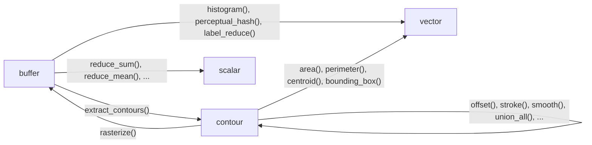

# Domains

A pipeline tracks the **domain** of its current value: what kind of data the
next operation receives. Each operation declares the domains it accepts and the
one it produces, so an operation applied to the wrong kind of data raises when
the pipeline is built, not when it runs. Each method's docstring in the
[API reference](../../api/pipeline.md) has a `Domain:` line saying which.

## Domain Types

| Domain | Description | Example Data |
|--------|-------------|--------------|
| `buffer` | An N-dimensional array | Decoded pixels, masks, tensors, distance fields |
| `contour` | Geometry: regions (with holes) and open lines, one or a set per row | Traced outlines, annotations, strokes |
| `scalar` | A single number | A global `reduce_sum()`, `reduce_mean()` |
| `vector` | A 1-D array of numbers | Histogram buckets, a perceptual hash, per-contour areas, a shape |

## Domain Transitions



### Buffer → Contour

Trace the regions of a binary mask:

```python
import polars as pl
from polars_cv import Pipeline

pipe = (
    Pipeline()
    .source("image_bytes")
    .grayscale()
    .threshold(128)
    .extract_contours()
)

df = pl.DataFrame({"image": [png_bytes]})
# "native" returns the contours as structs
result = df.with_columns(contours=pl.col("image").cv.pipe(pipe).sink("native"))
```

### Contour → Contour

Contour operations reshape geometry without leaving the domain: `offset` grows
or shrinks regions, `stroke` turns lines and outlines into the regions they
cover when drawn, `smooth` and `densify` refine outlines, `boundary` and
`close` convert between regions and lines, and `union`, `intersection`,
`difference` and `symmetric_difference` combine two contour expressions. See
[Geometry Operations](../operations/geometry.md#shaping) and
[Drawing](../drawing.md).

```python
halo = Pipeline().source("contour").offset(3.0).rasterize(width=200, height=200)
```

### Contour → Buffer

Rasterize contours into a mask:

```python
from polars_cv import CONTOUR_SCHEMA

square = {
    "exterior": [{"x": 10.0, "y": 10.0}, {"x": 60.0, "y": 10.0},
                 {"x": 60.0, "y": 60.0}, {"x": 10.0, "y": 60.0}],
    "holes": [],
    "is_closed": True,
}
df = pl.DataFrame({"contour": [square]}, schema={"contour": CONTOUR_SCHEMA})

pipe = Pipeline().source("contour").rasterize(width=200, height=200)
result = df.with_columns(mask=pl.col("contour").cv.pipe(pipe).sink("numpy"))
```

### Contour → Vector

Measure contours in a pipeline, or directly on a contour column with the
`.contour` namespace (each accessor that is also a pipeline op runs that same
op):

```python
result = df.with_columns(
    area=pl.col("contour").contour.area(),
    perimeter=pl.col("contour").contour.perimeter(),
    centroid=pl.col("contour").contour.centroid(),
    bbox=pl.col("contour").contour.bounding_box(),
)
```

## Type Inference

The output type of a pipeline is known when Polars plans the query: it follows
from the operations, their parameters and the `.sink()` format, so
`collect_schema()` reports it without running anything.

```python
# Binary (PNG bytes)
pl.col("image").cv.pipe(pipe).sink("png")

# Float64
pl.col("contour").contour.area()
```
