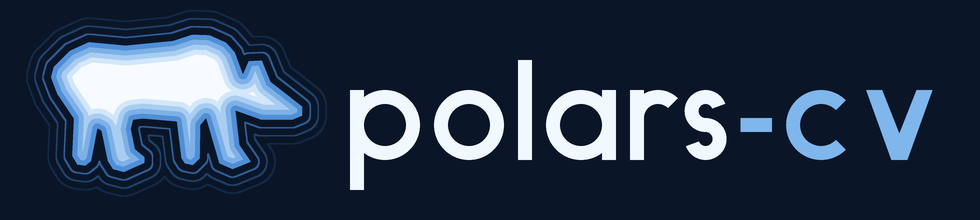

# Drawing with polars-cv

polars-cv draws. Contours are vector shapes, `rasterize` renders them, and the
image ops shade the result — all as Polars expressions, so a drawing is a
query and a column of drawings is one more row each. The project's logo is
made this way, start to finish
([`docs/assets/logo/make_logo.py`](https://github.com/heshamdar/polars-cv/blob/main/polars-cv/docs/assets/logo/make_logo.py)):



This page builds up the pieces it uses. Every example runs as written.

## Shapes are data

A contour is a struct of `exterior` points, `holes` and `is_closed`
([`CONTOUR_SCHEMA`](../api/geometry.md)); a column of contour *sets* holds a
drawing per row. A closed contour is a **region** (its exterior minus its
holes); an open one (`is_closed=False`) is a **line**.

```python
import math

import polars as pl

from polars_cv import Pipeline, numpy_from_column
from polars_cv.geometry.schemas import CONTOUR_SET_SCHEMA


def pts(points):
    return [{"x": float(x), "y": float(y)} for x, y in points]


def region(points, holes=()):
    return {"exterior": pts(points), "holes": [pts(h) for h in holes], "is_closed": True}


def line(points):
    return {"exterior": pts(points), "holes": [], "is_closed": False}


ring = region(
    [(4, 4), (28, 4), (28, 28), (4, 28)], holes=[[(12, 12), (20, 12), (20, 20), (12, 20)]]
)
zigzag = line([(2, 30), (10, 22), (18, 30), (26, 22)])
drawing = pl.DataFrame({"c": [[ring, zigzag]]}, schema={"c": CONTOUR_SET_SCHEMA})
```

## Filling and stroking

`rasterize` fills a set's regions, as one union. A line has no region to
fill, so it is drawn by **stroking** first: `stroke(width=, cap=, join=)` is
the region every point within `width / 2` of a path covers, its ends shaped
by `cap` (`"round"`, `"square"`, `"butt"`) and its corners by `join`
(`"round"`, `"miter"`, `"bevel"`). Every member is read as its outline, so
stroking a region draws its rings (a closed path has no ends, and neither has
a line that returns to its first point). To draw lines and fill regions in
one picture, rasterize the two sets as separate layers and stack them.

`supersample=n` anti-aliases: each pixel samples `n x n` points and is painted
in proportion to those inside.

```python
import polars as pl

from polars_cv import Pipeline, numpy_from_column
from polars_cv.geometry.schemas import CONTOUR_SET_SCHEMA

square = {
    "exterior": [{"x": x, "y": y} for x, y in [(4.0, 4.0), (28.0, 4.0), (28.0, 28.0), (4.0, 28.0)]],
    "holes": [],
    "is_closed": True,
}
df = pl.DataFrame({"c": [[square]]}, schema={"c": CONTOUR_SET_SCHEMA})

filled = Pipeline().source("contour").rasterize(width=32, height=32, supersample=4)
outlined = (
    Pipeline().source("contour")
    .stroke(width=3.0, join="miter")
    .rasterize(width=32, height=32, supersample=4)
)
masks = df.select(
    filled=pl.col("c").cv.pipe(filled).sink("numpy"),
    outlined=pl.col("c").cv.pipe(outlined).sink("numpy"),
)
(outline,) = numpy_from_column(masks["outlined"], copy=True)
assert outline[16, 16, 0] == 0 and outline[4, 16, 0] == 255  # hollow, edge drawn
```

## Shaping geometry

The contour ops edit shapes before they are drawn. Each is a pipeline op and
a `.contour` accessor (see [Geometry](operations/geometry.md#shaping)):

| Op | What it does |
|----|--------------|
| `offset(distance, join=)` | Grow a set's regions (shrink, negative); merges or splits them |
| `union_all()` | Merge a set into disjoint regions |
| `union` / `intersection` / `difference` / `symmetric_difference` | Combine two sets |
| `smooth(iterations=)` | Round corners (Chaikin) |
| `densify(max_segment_length)` | Add points so no edge is longer than the bound |
| `simplify(tolerance)` | Drop points (Douglas-Peucker): facets |
| `boundary()` / `close()` | A region's rings as lines, and back |
| `stroke(width=, cap=, join=)` | The region a set's paths cover when drawn |

A halo is an offset; a crescent is a difference:

```python
import math

import polars as pl

from polars_cv import Pipeline
from polars_cv.geometry.schemas import CONTOUR_SET_SCHEMA


def disc(cx, cy, r, n=64):
    ring = [
        {"x": cx + r * math.cos(2 * math.pi * i / n), "y": cy + r * math.sin(2 * math.pi * i / n)}
        for i in range(n)
    ]
    return {"exterior": ring, "holes": [], "is_closed": True}


df = pl.DataFrame(
    {"moon": [[disc(32, 32, 20)]], "shadow": [[disc(42, 26, 18)]]},
    schema={"moon": CONTOUR_SET_SCHEMA, "shadow": CONTOUR_SET_SCHEMA},
)
crescent = pl.col("moon").contour.difference(pl.col("shadow"))
halo = crescent.contour.offset(3.0).contour.difference(crescent)
out = df.select(crescent=crescent, halo=halo)
assert out["halo"].list.len().item() >= 1
```

## Fields over pixels

Some looks are easiest as a value per pixel, shaded afterwards:

- `distance_transform(signed=True)` gives each pixel its distance to a mask's
  edge, negative inside: iso-lines of it are inward and outward offsets.
- `coordinate_grid(normalized=)` gives each pixel its own `(x, y)`, for
  gradients and falloffs built with the arithmetic ops.

```python
import numpy as np
import polars as pl

from polars_cv import Pipeline, numpy_from_column

df = pl.DataFrame({"m": [np.zeros((48, 64), np.uint8)]}, schema={"m": pl.Array(pl.UInt8, (48, 64))})
# A horizontal ramp from 0 to 255, then quantised to 4 bands.
ramp = (
    Pipeline().source("array")
    .coordinate_grid(normalized=True)
    .channel_select(0)
    .scale(4.0)
    .floor()
    .scale(85.0)
    .clamp(0, 255, out_dtype="u8")
)
(bands,) = numpy_from_column(df.select(pl.col("m").cv.pipe(ramp).sink("numpy")).to_series(), copy=True)
assert set(np.unique(bands)) == {0, 85, 170, 255}
```

## Colour: an index map and a palette

Rather than mixing colour channels by hand, paint each layer as a small
integer **index**, combine the layers with `maximum` (a higher index is drawn
over a lower one), and colour the result once with `apply_lut`: a table of one
`[r, g, b]` row per index takes the single-channel map to three channels.

`rasterize(fill_value=)` paints a layer at its index; `floor` and
`clamp(out_dtype="u8")` turn a field into indices.

```python
import polars as pl

from polars_cv import Pipeline
from polars_cv.geometry.schemas import CONTOUR_SET_SCHEMA


def rect(x0, y0, x1, y1, closed=True):
    corners = [(x0, y0), (x1, y0), (x1, y1), (x0, y1)]
    return {"exterior": [{"x": float(x), "y": float(y)} for x, y in corners], "holes": [], "is_closed": closed}


df = pl.DataFrame(
    {"base": [[rect(4, 4, 44, 44)]], "mark": [[rect(16, 16, 32, 32, closed=False)]]},
    schema={"base": CONTOUR_SET_SCHEMA, "mark": CONTOUR_SET_SCHEMA},
)
palette = [[10, 22, 40], [79, 143, 214], [247, 251, 255]]  # background, base, mark
canvas = {"width": 48, "height": 48}
base = pl.col("base").cv.pipe(Pipeline().source("contour").rasterize(**canvas, fill_value=1))
mark = pl.col("mark").cv.pipe(
    Pipeline().source("contour").stroke(width=3.0).rasterize(**canvas, fill_value=2)
)
png = df.select(base.maximum(mark).apply_lut(palette).sink("png")).item()
assert png[:4] == b"\x89PNG"
```

An index map has no in-between values, so its edges are hard. Draw it at a
multiple of the target size and `resize` down (lanczos averages each block):
that anti-aliases every layer at once, which `supersample` cannot do for
indices.

## The logo

[`make_logo.py`](https://github.com/heshamdar/polars-cv/blob/main/polars-cv/docs/assets/logo/make_logo.py)
puts it together, as one graph over five contour columns at four times the
final size:

1. **The bear** (`bear.py`): overlapping ellipses and capsules are rasterized,
   blurred and thresholded so they fuse into one body (the metaball trick),
   then traced with `extract_contours` and faceted with `simplify`.
2. **Terraces**: the bear's mask through `distance_transform(signed=True)`,
   its depth over the terrace step `floor`ed into indices 1 to 5.
3. **Contour lines**: the bear `offset` outward three times, each offset
   `stroke`d and rasterized at its own index.
4. **The wordmark** (`wordmark.py`): glyph centrelines stroked at the font's
   weight with butt caps, and the `v`'s polygon filled, as two layers.
5. `maximum` stacks the layers, `apply_lut` colours them, and a lanczos
   `resize` to the final size anti-aliases the lot into a PNG.

## Another take: a halftone bear

[`halftone_logo.py`](https://github.com/heshamdar/polars-cv/blob/main/polars-cv/docs/assets/logo/halftone_logo.py)
draws the bear with no hand-placed points and no outline at all:


1. **A polar bear in polar coordinates.** Each part of the face is one row of
   a DataFrame describing a curve `r(θ)`: the head is a circle widened by a
   `cos 2θ` term with an ear grown out of each side of the crown, and the nose
   is a `cos 3θ` rounded triangle. `int_ranges` + `explode` sample the curves,
   expressions evaluate them, and `group_by` + `implode` gather the points
   into contour sets: the geometry is a polars query.
2. **The silhouette emerges from dot size.** The head's
   `distance_transform(signed=True)` sets a dot radius per pixel, stepping up
   at the edge, growing inward and fading outward. A `resize` down to the cell
   grid and back up with `filter="nearest"` samples it once per cell;
   `coordinate_grid` minus its own `floor` is each pixel's offset in its cell,
   and a dot is wherever that offset is shorter than the radius.
3. The muzzle's dots take a second index, the eyes and nose are inked over
   them, and `apply_lut` colours the map as above, with an RGBA palette whose
   background is transparent. Each letter sits on an ink outline (the letter
   grown by `offset(..., join="miter")`), so the logo reads on a light page as
   well as a dark one.

`channel_select` returns `[H, W]`, while `rasterize` returns `[H, W, 1]`.
The binary ops need operands of one shape (NumPy would broadcast the pair to
`[H, W, W]` on a square canvas), so the halftone brings every layer to rank 2
with `channel_select(0)`; `squeeze(-1)` and `expand_dims(-1)` do the same
where a layer's channel axis is all that differs.
